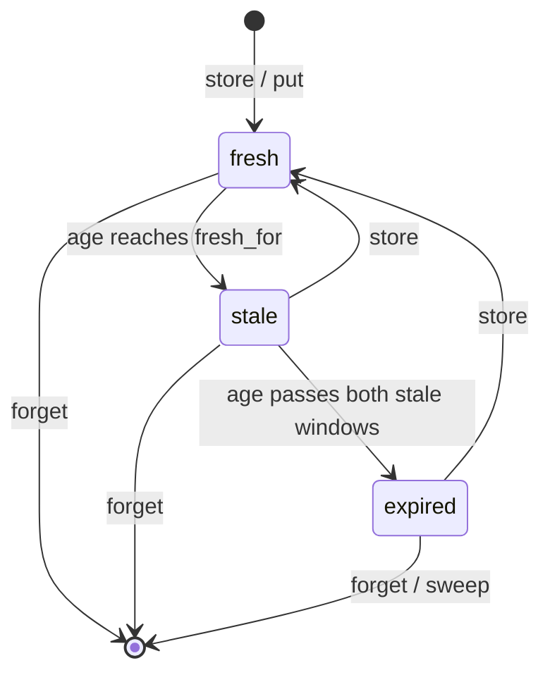
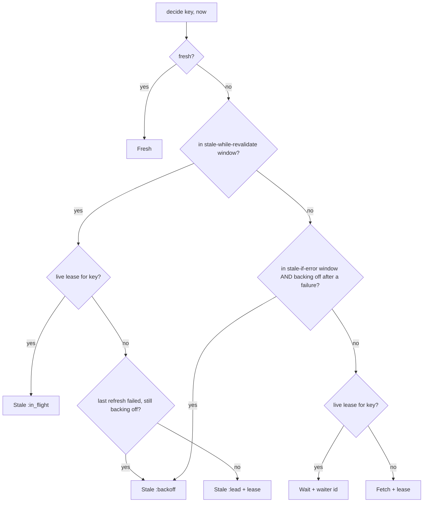
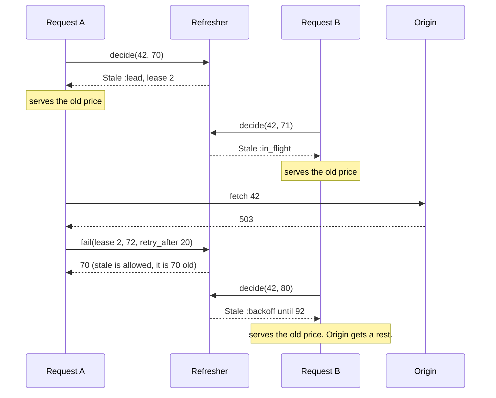

# RefreshMachines

> A stale answer now beats a perfect answer after the timeout. Sometimes. 🧊

A freshness officer for Ruby caches. You tell it how old a value was when you stored it and three durations: how long it is fresh, how long it may be served while someone refreshes it, and how long it may be served if the refresh fails. Then you ask before every read. It answers serve it, serve it and refresh in the background, go fetch, or wait for the caller who is already fetching. One caller per key gets the refresh. Everyone else gets an answer.

This is an initial, unstable API. It is a policy core, not a cache: it holds no values, makes no requests, and evicts nothing.

## Quick Start

```bash
gem 'refresh_machines'
```

```ruby
RULES = RefreshMachines::Policy.new(60, 30, 300) # fresh 60s, +30s while revalidating, +300s on error
refresher = RefreshMachines::Refresher.new

def read(refresher, cache, key, now)
  case (decision = refresher.decide(key, now, 10))
  in RefreshMachines::Fresh
    cache[key]
  in RefreshMachines::Stale(revalidation: :lead, lease_id:)
    RefreshJob.enqueue(key, lease_id) # you are the one refreshing it
    cache[key]
  in RefreshMachines::Stale
    cache[key] # someone else is on it, or the origin is resting
  in RefreshMachines::Fetch(lease_id:)
    begin
      cache[key] = origin_fetch(key)
      refresher.store(lease_id, now, 0, RULES)
      cache[key]
    rescue OriginDown
      refresher.fail(lease_id, now, 5).is_a?(Integer) ? cache[key] : raise
    end
  in RefreshMachines::Wait(waiter_id:)
    park(waiter_id) # woken from refresher.drain, then read again
  in Symbol
    raise "refresher refused #{key}: #{decision}"
  end
end
```

One refresher, one question, three ways to report back: `store`, `fail`, `abandon`. Keys, times, ages and durations are Integers in whatever unit your clock counts, as long as it only goes forward.

## A Message to the Resistance

So your product page is cached for sixty seconds. At second sixty-one, four hundred requests arrive, find the entry expired, and all four hundred go ask the database the same question. The database, which was fine, is now not fine. You have built a metronome that attacks you once a minute.

So you add a lock. One request refreshes, three hundred ninety-nine wait. They wait for a value that was perfectly good ninety seconds ago, on a page whose price changes twice a year. Then the pricing service has a bad afternoon, the refresh throws, and your cache dutifully serves four hundred errors, because the only thing it had was "expired" and expired means gone.

Mark Nottingham wrote this down in RFC 5861 in 2010, in two directives. `stale-while-revalidate`: keep serving the old one while one of you fetches the new one. `stale-if-error`: if the fetch fails, the old one is better than nothing, for a while. Your CDN has done this for years. Your application cache does `fetch(key, expires_in: 60)` and hopes.

The part you keep getting wrong isn't the fetch. It's the bookkeeping: how old is this, which window is it in, is anyone already refreshing it, did the last refresh fail, and is the caller who promised to refresh it still alive. That bookkeeping is this gem.

## Chapter 1: Stardate 2026.316, the AMS Nottingham

> **AMS Nottingham**, NCC-4230, *Nottingham*-class resupply tender.
> Issue what is aboard. Send one boat for more.

The tender doesn't grow food and it doesn't decide what gets thrown overboard. It keeps the date stamps. Every crate in the hold has an age and three lines on its label: good until, usable while the resupply boat is out, usable if the boat comes back empty. The quartermaster reads the label and says issue it, issue it and launch the boat, or nobody eats until the boat is back.

On a bridge somewhere, a cadet volunteers:

```ruby
def product(id)
  Rails.cache.fetch("product:#{id}", expires_in: 60) { Product.find(id) }
end
```

"That," says the tender's quartermaster, "throws out the rations at midnight and sends the whole crew to the planet for lunch."

## The Flight Plan

Each value moves through its windows by age alone:



And what a caller is told depends on the window, the lease, and the last refresh:



The minute the pricing service went down, with `Policy.new(60, 30, 300)`:



## How the Refresher Works

### Policy

```ruby
rules = RefreshMachines::Policy.new(10, 5, 20)

rules.state(9)               # => :fresh
rules.state(10)              # => :stale
rules.while_revalidate?(14)  # => true
rules.while_revalidate?(15)  # => false
rules.if_error?(29)          # => true
rules.state(30)              # => :expired
```

Three durations. Fresh while the age is below `fresh_for`. Both stale windows start when freshness ends, so this value is revalidate-servable for ages 10 to 14 and error-servable for ages 10 to 29. A zero window turns its rule off. Past both, the value is `:expired` and is never served.

### Decide

```ruby
refresher = RefreshMachines::Refresher.new

fetch = refresher.decide(42, 0, 100)   # key 42, now 0, lease good for 100
fetch.class                            # => RefreshMachines::Fetch
refresher.decide(42, 1, 100).class     # => RefreshMachines::Wait
```

Nothing is cached, so the first caller fetches and the second waits. The third argument is how long the lease holder has to report back.

### Store

```ruby
refresher.store(fetch.lease_id, 2, 0, rules)   # => :stored
refresher.decide(42, 5, 100)                   # => #<data RefreshMachines::Fresh age=3>
refresher.drain(10).map(&:outcome)             # => [:completed]
```

`store` says the value under that lease's key is new as of `now`. The third argument is its age on arrival: zero if the origin just made it, more if it came through another cache that had held it a while. The waiter gets a notification and asks again.

To record a value you wrote without being asked, use `put(key, now, age, policy)`.

### Stale while revalidate

```ruby
lead = refresher.decide(42, 12, 100)
lead.revalidation                        # => :lead
refresher.decide(42, 13, 100).revalidation   # => :in_flight
refresher.waiting                        # => 0
```

Age 10, inside the revalidate window. Both callers serve the old value. The first one also gets a `lease_id` and the job of refreshing it. Nobody waits.

### Fail, and stale if error

```ruby
refresher.fail(lead.lease_id, 14, 5)   # => 12
refresher.decide(42, 18, 100)
# => #<data RefreshMachines::Stale age=16, revalidation=:backoff, lease_id=nil, retry_at=19>
```

`fail` returns the age of the old value if its stale-if-error window is open, or `nil` if there is nothing to fall back on. The third argument is how long to leave the origin alone. Until then callers are served stale and nobody is handed a lease.

Outside the revalidate window the error window does not serve anything on its own. The caller gets `Fetch` and must try. Only a failure makes the old value servable:

```ruby
fetch = refresher.decide(42, 19, 100)
fetch.class    # => RefreshMachines::Fetch, at age 17 the revalidate window is over
```

### Abandon

```ruby
refresher.abandon(fetch.lease_id)        # => :abandoned
refresher.decide(42, 19, 100).class      # => RefreshMachines::Fetch
```

The request was cancelled, the job was shed, the fetch never ran. That isn't a failure, so no backoff starts. The next caller leads.

### Overdue leases

```ruby
refresher = RefreshMachines::Refresher.new
dead = refresher.decide(7, 0, 10)       # lease due back by 10
refresher.decide(7, 9, 10).class        # => RefreshMachines::Wait
heir = refresher.decide(7, 10, 10)      # => a Fetch with a new lease
refresher.store(dead.lease_id, 11, 0, rules)   # => :stale
refresher.reap(20)                      # => 1
```

A worker that dies holding a lease would otherwise hold the key forever. At the deadline the next caller who needs a refresh takes it over, and the old lease is refused from then on. Waiters stay parked and are woken by the new leader. `reap(now)` revokes overdue leases nobody came back for, so their waiters get `:abandoned` instead of silence.

### Forget and sweep

```ruby
refresher.put(42, 20, 0, rules)   # => :stored
refresher.put(43, 20, 0, rules)   # => :stored
refresher.forget(43)              # => true
refresher.forget(43)              # => false
refresher.sweep(1_000, 50)        # => [42]
```

`forget` is for when your cache evicts a value. `sweep(now, max)` drops up to `max` expired entries and returns their keys so you can delete the values too. Call it again for the rest.

### Capacity

```ruby
RefreshMachines::Refresher::CAPACITY          # => 256 keys with metadata
RefreshMachines::Refresher::FLIGHT_CAPACITY   # => 64 refreshes in progress
RefreshMachines::Refresher::WAITER_CAPACITY   # => 256 waiters plus undrained notifications
```

Past those, `put` and `store` say `:entries_full`, and `decide` says `:flights_full` or `:waiters_full`. Nothing is evicted to make room. One exception that isn't one: if a stale value is servable and the refresh can't be registered, you still get `Stale`, with the reason in `revalidation`.

### Time only moves forward

```ruby
refresher = RefreshMachines::Refresher.new
refresher.put(1, 10, 0, rules)   # => :stored
refresher.decide(1, 9, 100)      # => :time_regressed
refresher.decide(1, 10, 0)       # => :rejected, a zero lease is overdue at birth
```

## The Rules of the Quartermaster

- **Everything is an Integer** in `0..2**64-1`. Floats, nil and strings raise `TypeError`. Out of range raises `RangeError`. A policy argument that isn't a `Policy` raises `TypeError`.
- **Refusals don't raise.** `:time_regressed`, `:rejected`, `:entries_full`, `:flights_full`, `:waiters_full`, `:exhausted` and `:stale` are answers, and a refused call changes nothing.
- **A lease is a capability.** Whoever holds the `lease_id` reports the refresh. Reported, abandoned, reaped or taken over, it answers `:stale` forever.
- **Scopes keep refreshers apart.** Lease and waiter ids are plain Integers counted from 1, so two refreshers issue the same ones, and an id handed to the wrong refresher can name a live lease or waiter there. If you run more than one, or a `CoalesceMachines::Coalescer` beside it, give each its own scope: `Refresher.new(scope: 3)`, any Integer in `0..65_535`. An id from another scope is always `:stale`. A `scope:` that isn't an Integer raises `TypeError`; out of range raises `RangeError`.
- **Waiters ask again.** A notification says the refresh settled, `:completed` or `:abandoned`. It doesn't carry a decision. Call `decide` again.
- **Frozen means frozen.** `freeze` the refresher and every mutating call raises `FrozenError`.

## What You Think You're Doing vs Reality

### You Think: "The entry expired, so I refetch."
### Reality: So does everyone else.

Expiry is one instant shared by every request for that key. `decide` hands the refresh to exactly one caller and tells the rest to serve what they have or wait.

### You Think: "If the refresh fails I'll just raise."
### Reality: You had a working answer and threw it away.

A value that was good enough a minute ago is usually good enough during an outage. `stale_if_error` is how long you're willing to believe that. `fail` tells you whether you still are.

### You Think: "stale-if-error means I can serve stale whenever."
### Reality: It means you tried.

Past the revalidate window `decide` says `Fetch`, not `Stale`. The old value becomes servable when a refresh has actually failed, and stays servable only for the backoff you asked for.

## What's Yours

The values. The refresher never sees them, so keeping `cache[key]` and its metadata in step is your job: `forget` when you evict, delete when `sweep` tells you. Which keys to keep at all is an eviction question, and that's [cache_machines](https://github.com/seuros/cache_machines).

The clock, the fetch, the retry schedule and the parking lot. You pass `now`, you run the request, you pick each `retry_after`, and you wake whatever is waiting under a `waiter_id`. Parsing `Cache-Control` into three durations is yours too.

The process boundary. State lives in memory in one refresher and is gone on restart. Two processes each elect their own leader for the same key. A lease that times out may belong to a worker that's still running: its late `store` is refused here, but its request already hit your origin.

## License

MIT License. See [LICENSE.txt](LICENSE.txt) for details.

**Remember: the old value was fine a second ago. Ask before you throw it out.**
