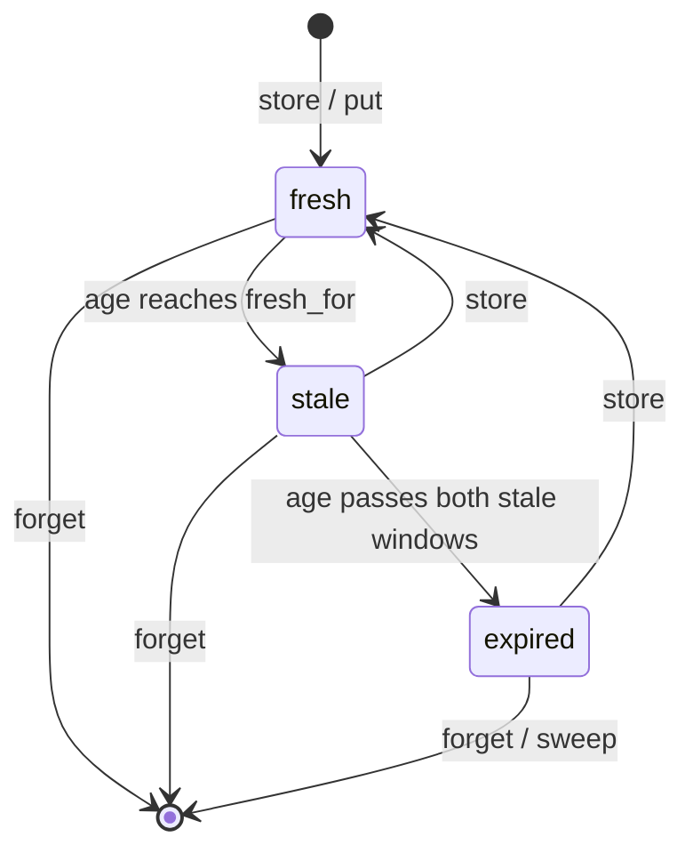
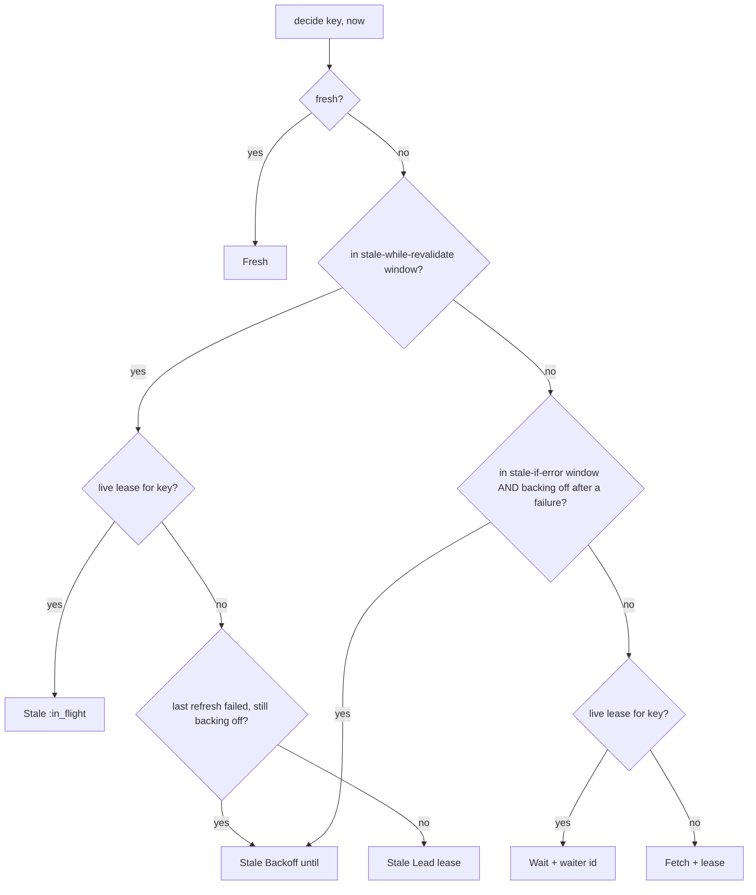
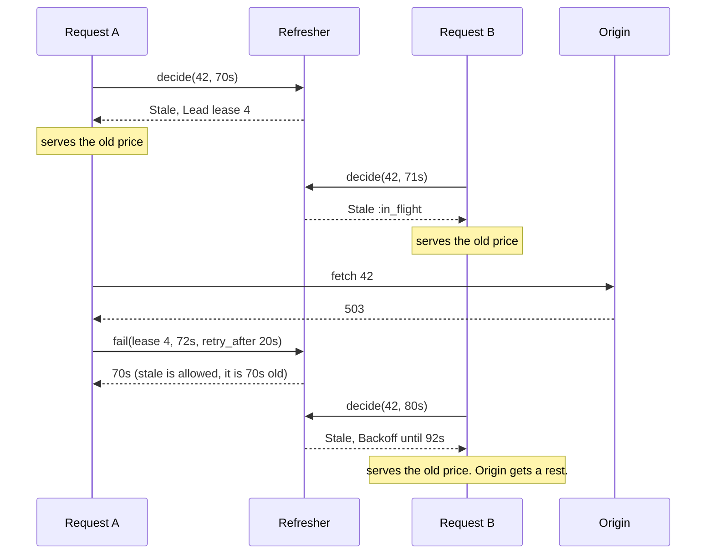

# RefreshMachines

> A stale answer now beats a perfect answer after the timeout. Sometimes. 🧊

A freshness officer for Ruby caches. You tell it how old a value was when you stored it and three durations: how long it is fresh, how long it may be served while someone refreshes it, and how long it may be served if the refresh fails. Then you ask before every read. It answers serve it, serve it and refresh in the background, go fetch, or wait for the caller who is already fetching. One caller per key gets the refresh. Everyone else gets an answer.

This is an initial, unstable API. It is a policy core, not a cache: it holds no values, makes no requests, and evicts nothing.

## Quick Start

```bash
gem 'refresh_machines'
```

```ruby
S = 1_000_000_000 # every instant and span is Integer nanoseconds
RULES = RefreshMachines::Policy.new(60 * S, 30 * S, 300 * S) # fresh 60s, +30s while revalidating, +300s on error
refresher = RefreshMachines::Refresher.new

def read(refresher, cache, key)
  now = Process.clock_gettime(Process::CLOCK_MONOTONIC, :nanosecond)
  case (decision = refresher.decide(key, now, 10 * S)) # the lease holder has 10s to report
  in RefreshMachines::Fresh
    cache[key]
  in RefreshMachines::Stale(revalidation: RefreshMachines::Lead(lease:))
    RefreshJob.enqueue(key, lease) # you are the one refreshing it
    cache[key]
  in RefreshMachines::Stale
    cache[key] # someone else is on it, or the origin is resting
  in RefreshMachines::Fetch(lease:)
    begin
      cache[key] = origin_fetch(key)
      refresher.store(lease, now, 0, RULES)
      cache[key]
    rescue OriginDown
      refresher.fail(lease, now, 5 * S).is_a?(Integer) ? cache[key] : raise
    end
  in RefreshMachines::Wait(waiter:, flight:)
    park(waiter, flight) # woken from refresher.drain, then read again
  in Symbol
    raise "refresher refused #{key}: #{decision}"
  end
end
```

One refresher, one question, three ways to report back: `store`, `fail`, `abandon`. Keys are Integers. Time is Integer nanoseconds everywhere, in and out: `now` straight from `Process.clock_gettime(Process::CLOCK_MONOTONIC, :nanosecond)`, and every age, window, `lead_for`, `retry_after` and `Backoff#until` in the same unit. No floats, no seconds, no milliseconds. The clock only goes forward.

## A Message to the Resistance

So your product page is cached for sixty seconds. At second sixty-one, four hundred requests arrive, find the entry expired, and all four hundred go ask the database the same question. The database, which was fine, is now not fine. You have built a metronome that attacks you once a minute.

So you add a lock. One request refreshes, three hundred ninety-nine wait. They wait for a value that was perfectly good ninety seconds ago, on a page whose price changes twice a year. Then the pricing service has a bad afternoon, the refresh throws, and your cache dutifully serves four hundred errors, because the only thing it had was "expired" and expired means gone.

Mark Nottingham wrote this down in RFC 5861 in 2010, in two directives. `stale-while-revalidate`: keep serving the old one while one of you fetches the new one. `stale-if-error`: if the fetch fails, the old one is better than nothing, for a while. Your CDN has done this for years. Your application cache does `fetch(key, expires_in: 60)` and hopes.

The part you keep getting wrong isn't the fetch. It's the bookkeeping: how old is this, which window is it in, is anyone already refreshing it, did the last refresh fail, and is the caller who promised to refresh it still alive. That bookkeeping is this gem.

## Chapter 1: Stardate 2026.316, the AMS Nottingham

> **AMS Nottingham**, NCC-4230, *Nottingham*-class resupply tender.
> Issue what is aboard. Send one boat for more.

The tender doesn't grow food and it doesn't decide what gets thrown overboard. It keeps the date stamps. Every crate in the hold has an age and three lines on its label: good until, usable while the resupply boat is out, usable if the boat comes back empty. The quartermaster reads the label and says issue it, issue it and launch the boat, or nobody eats until the boat is back.

On a bridge somewhere, a cadet volunteers:

```ruby
def product(id)
  Rails.cache.fetch("product:#{id}", expires_in: 60) { Product.find(id) }
end
```

"That," says the tender's quartermaster, "throws out the rations at midnight and sends the whole crew to the planet for lunch."

## The Flight Plan

Each value moves through its windows by age alone:



And what a caller is told depends on the window, the lease, and the last refresh:



The minute the pricing service went down, with `Policy.new(60 * S, 30 * S, 300 * S)` (the diagram counts in seconds; the calls take nanoseconds):



## How the Refresher Works

### Policy

```ruby
S = 1_000_000_000
rules = RefreshMachines::Policy.new(10 * S, 5 * S, 20 * S)

rules.state(9 * S)               # => :fresh
rules.state(10 * S)              # => :stale
rules.while_revalidate?(14 * S)  # => true
rules.while_revalidate?(15 * S)  # => false
rules.if_error?(29 * S)          # => true
rules.state(30 * S)              # => :expired
```

Three spans, in nanoseconds. Fresh while the age is below `fresh_for`. Both stale windows start when freshness ends, so this value is revalidate-servable from 10s up to (not including) 15s old and error-servable from 10s up to 30s old. A zero window turns its rule off. Past both, the value is `:expired` and is never served.

### Decide

```ruby
refresher = RefreshMachines::Refresher.new

t0 = Process.clock_gettime(Process::CLOCK_MONOTONIC, :nanosecond)

fetch = refresher.decide(42, t0, 100 * S)       # key 42, now, lease good for 100s
fetch.class                                     # => RefreshMachines::Fetch
wait = refresher.decide(42, t0 + S, 100 * S)    # => #<data RefreshMachines::Wait waiter=3, flight=2>
wait.flight == refresher.flight(fetch.lease)    # => true
```

Nothing is cached, so the first caller fetches and the second waits. A `Fetch` has one field, `lease`: the lease id you report with. A `Wait` has `waiter` and `flight`, the same two fields in the same order as a `CoalesceMachines::Follower`: `waiter` is the id you park under, and `flight` is the refresh being shared, the one `flight(lease)` answers for the key's live lease and the one the notification will name. Neither carries the key; you already hold the one you asked about. The third argument is how long the lease holder has to report back.

### Store

```ruby
refresher.store(fetch.lease, t0 + (2 * S), 0, rules)   # => :stored
refresher.decide(42, t0 + (5 * S), 100 * S)            # => #<data RefreshMachines::Fresh age=3000000000>
refresher.drain(10).map(&:outcome)                     # => [:completed]
```

`store` says the value under that lease's key is new as of `now`. The third argument is its age on arrival: zero if the origin just made it, more if it came through another cache that had held it a while. The waiter gets a notification and asks again.

To record a value you wrote without being asked, use `put(key, now, age, policy)`.

### Stale while revalidate

```ruby
stale = refresher.decide(42, t0 + (12 * S), 100 * S)
stale.revalidation                                          # => #<data RefreshMachines::Lead lease=4>
lead = stale.revalidation
refresher.decide(42, t0 + (13 * S), 100 * S).revalidation   # => :in_flight
refresher.waiting                                           # => 0
```

Ten seconds old, inside the revalidate window. Both callers serve the old value. The first one also gets a `Lead` with a `lease` and the job of refreshing it. Nobody waits.

A `Stale` has two fields, `age` and `revalidation`, and `revalidation` is one of four things:

| `revalidation` | Meaning |
| --- | --- |
| `Lead(lease)` | Nobody was refreshing this key. You are now: report with `lease`. |
| `:in_flight` | Another caller holds a live lease. Just serve. |
| `Backoff(until)` | The last refresh failed and asked for quiet until that instant. Just serve. |
| `Unavailable(refusal)` | A refresh is due but could not be registered; `refusal` is `:flights_full` or `:exhausted`. Just serve. |

### Fail, and stale if error

```ruby
refresher.fail(lead.lease, t0 + (14 * S), 5 * S)   # => 12000000000
quiet = refresher.decide(42, t0 + (18 * S), 100 * S)
# => #<data RefreshMachines::Stale age=16000000000, revalidation=#<data RefreshMachines::Backoff until=...>>
quiet.revalidation.until == t0 + (19 * S)          # => true
```

`fail` returns the age of the old value if its stale-if-error window is open, or `nil` if there is nothing to fall back on. The third argument is how long to leave the origin alone. Until then callers are served stale and nobody is handed a lease.

Outside the revalidate window the error window does not serve anything on its own. The caller gets `Fetch` and must try. Only a failure makes the old value servable:

```ruby
fetch = refresher.decide(42, t0 + (19 * S), 100 * S)
fetch.class    # => RefreshMachines::Fetch, at 17s old the revalidate window is over
```

### Abandon

```ruby
refresher.abandon(fetch.lease)           # => :abandoned
refresher.decide(42, t0 + (19 * S), 100 * S).class   # => RefreshMachines::Fetch
```

The request was cancelled, the job was shed, the fetch never ran. That isn't a failure, so no backoff starts. The next caller leads.

### Overdue leases

```ruby
refresher = RefreshMachines::Refresher.new
dead = refresher.decide(7, t0, 10 * S)                  # lease due back within 10s
refresher.decide(7, t0 + (9 * S), 10 * S).class         # => RefreshMachines::Wait
heir = refresher.decide(7, t0 + (10 * S), 10 * S)       # => a Fetch with a new lease
refresher.store(dead.lease, t0 + (11 * S), 0, rules)    # => :stale
refresher.reap(t0 + (20 * S))                           # => 1
```

A worker that dies holding a lease would otherwise hold the key forever. At the deadline the next caller who needs a refresh takes it over, and the old lease is refused from then on. Waiters stay parked and are woken by the new leader. `reap(now)` revokes overdue leases nobody came back for, so their waiters get `:abandoned` instead of silence.

### Notifications and flights

```ruby
refresher = RefreshMachines::Refresher.new
fetch = refresher.decide(42, t0, 100 * S)
wait = refresher.decide(42, t0 + S, 100 * S)
flight = refresher.flight(fetch.lease)                 # the refresh this lease rides on
refresher.store(fetch.lease, t0 + (2 * S), 0, rules)   # => :stored
refresher.drain(10)
# => [#<data RefreshMachines::Notification waiter=3, flight=2, key=42, outcome=:completed>]
refresher.flight(fetch.lease)                          # => nil, the lease is spent
```

A notification has `waiter`, `flight`, `key` and `outcome`, the same four fields in the same order as a `CoalesceMachines::Notification`. `flight` names the refresh that settled, and `flight(lease)` tells you which one a live lease is riding, so you can file the result under it before you report and hand it to the waiters as they wake.

A takeover issues a new lease for the same flight: the heir's lease answers the same flight id, the dead one answers `nil`. So does any lease that was reported, abandoned, reaped, never issued, or issued by a refresher in another scope. Ask while the lease is live. Lease ids, waiter ids and flight ids all come from one sequence, so no two of them are ever the same number: here the lease is 1, its flight 2 and the waiter 3.

### Forget and sweep

```ruby
refresher.put(42, t0 + (20 * S), 0, rules)   # => :stored
refresher.put(43, t0 + (20 * S), 0, rules)   # => :stored
refresher.forget(43)                         # => :forgotten
refresher.forget(43)                         # => :not_held, nothing to drop, nothing changed
refresher.sweep(t0 + (1_000 * S), 50)        # => [42]
```

`forget` is for when your cache evicts a value. It never refuses: forgetting a key that has no metadata is the same request already satisfied, so it answers `:not_held`. `size` counts the keys with metadata and `empty?` says whether there are none. `sweep(now, max)` drops up to `max` expired entries and returns their keys so you can delete the values too. Call it again for the rest.

### Capacity

```ruby
RefreshMachines::Refresher::CAPACITY          # => 256 keys with metadata
RefreshMachines::Refresher::FLIGHT_CAPACITY   # => 64 refreshes in progress
RefreshMachines::Refresher::WAITER_CAPACITY   # => 256 waiters plus undrained notifications
```

Past those, `put` and `store` say `:entries_full`, and `decide` says `:flights_full` or `:waiters_full`. Nothing is evicted to make room. One exception that isn't one: if a stale value is servable and the refresh can't be registered, you still get `Stale`, with the reason in `revalidation`: `Unavailable(refusal: :flights_full)` or `Unavailable(refusal: :exhausted)`. That is an honoured answer, not a refusal: the stale value is served, and the refresh that couldn't be registered changed nothing.

### Time only moves forward

```ruby
refresher = RefreshMachines::Refresher.new
refresher.put(1, t0, 0, rules)         # => :stored
refresher.decide(1, t0 - 1, 100 * S)   # => :time_regressed
refresher.decide(1, t0, 0)             # => :rejected, a zero lease is overdue at birth
```

## The Rules of the Quartermaster

- **Everything is an Integer** in `0..2**64-1`. Floats, nil and strings raise `TypeError`. Out of range raises `RangeError`. A policy argument that isn't a `Policy` raises `TypeError`.
- **Time is Integer nanoseconds.** Instants (`now`, `Backoff#until`) and spans (ages, the three policy windows, `lead_for`, `retry_after`) alike, in and out. A Float, a Rational or anything else that isn't an Integer raises `TypeError`; a negative one or one past `2**64-1` raises `RangeError`. Nothing wraps: a returned age or `Backoff#until` is the exact sum, even when that is larger than any argument you could pass back in.
- **Refusals don't raise.** `:time_regressed`, `:rejected`, `:entries_full`, `:flights_full`, `:waiters_full`, `:exhausted` and `:stale` are answers, and a refused call changes nothing.
- **Every answer, by method.**

  | Method | Honoured | Refused |
  | --- | --- | --- |
  | `decide(key, now, lead_for)` | a `Fresh`, `Stale`, `Fetch` or `Wait` | `:time_regressed`, `:rejected`, and, only when nothing is servable, `:flights_full`, `:waiters_full`, `:exhausted` |
  | `store(lease, now, age, policy)` | `:stored` | `:time_regressed`, `:stale`, `:entries_full` |
  | `fail(lease, now, retry_after)` | the age of the value that covers for the failure (Integer), or `nil` when nothing does | `:time_regressed`, `:stale` |
  | `abandon(lease)` | `:abandoned` | `:stale` |
  | `reap(now)` | leases revoked (Integer) | `:time_regressed` |
  | `put(key, now, age, policy)` | `:stored` | `:time_regressed`, `:entries_full` |
  | `forget(key)` | `:forgotten` when there was metadata to drop, `:not_held` when there was none (an idempotent repeat) | never refuses |
  | `sweep(now, max)` | an Array of swept keys | `:time_regressed` |
  | `cancel(waiter)` | `:cancelled` | `:stale` |
  | `poll` | the oldest queued `Notification`, `nil` when nothing is queued | never refuses |
  | `drain(max)` | an Array of `Notification`, `[]` when nothing is queued | never refuses |

  Every refusal has its own symbol; there is no catch-all.
- **A lease is a capability.** Whoever holds the lease id reports the refresh. Reported, abandoned, reaped or taken over, it answers `:stale` forever.
- **Scopes: ids belong to the refresher that issued them.** Lease, waiter and flight ids are plain Integers, so two refreshers in the same scope issue the same ones, and an id handed to the wrong refresher can name a live lease or waiter there. If you run more than one, or a `CoalesceMachines::Coalescer` beside it, give each its own scope: `Refresher.with_scope(3)`, any Integer in `0..65_535`. `Refresher.new` is scope zero and counts 1, 2, 3 across leases, flights and waiters alike. The scope rides in the top 16 bits of every id, above a 48-bit sequence, and an id from another scope is always `:stale` (`nil` from `flight`). The refresher can't pick a scope for you. `RefreshMachines.scope_of(id)` reads the scope back, so you can route an id to the refresher that issued it. It is the only layout helper the gem has: the layout belongs to the Rust crate `periscope-machines`, which has no gem. A scope that isn't an Integer raises `TypeError`; out of range raises `RangeError`.
- **One sequence: a lease number is never a waiter number.** Leases, waiter ids and flight ids are bare Integers, so nothing but their values tells them apart, and the refresher draws all three from one sequence: no two ids it issues are equal. Pass a lease to `cancel`, or a waiter or flight id to `store`, `fail`, `abandon` or `flight`, and you get `:stale` (`nil` from `flight`) with nothing changed. A new refresh takes two numbers, its lease and then its flight; a takeover and a wait take one. After `2**48 - 1` of them `decide` answers `:exhausted` wherever it would need an id, and a full table is reported first: `:flights_full` or `:waiters_full` before `:exhausted`.
- **Restarts: resume the sequence, or take a new scope.** A new refresher counts from one again, so a lease or waiter id that outlived a restart could name a new refresh. Either save `issued` and build the replacement with `Refresher.resumed(scope, issued)`, which is empty, at time zero, and carries on after the saved count (`nil` if `issued` is more than `2**48 - 1`), or give each incarnation a scope it never had before.
- **Repeats are refused.** A second `store`, `fail`, or `abandon` on a settled lease, and a second `cancel` on a waiter that left, are `:stale`: the refresher keeps nothing about how a lease or waiter ended.
- **Waiters ask again.** A notification says which refresh settled (`flight`) and how, `:completed` or `:abandoned`. It doesn't carry a decision. Call `decide` again.
- **Frozen means frozen.** `freeze` the refresher and every mutating call raises `FrozenError`.

## What You Think You're Doing vs Reality

### You Think: "The entry expired, so I refetch."
### Reality: So does everyone else.

Expiry is one instant shared by every request for that key. `decide` hands the refresh to exactly one caller and tells the rest to serve what they have or wait.

### You Think: "If the refresh fails I'll just raise."
### Reality: You had a working answer and threw it away.

A value that was good enough a minute ago is usually good enough during an outage. `stale_if_error` is how long you're willing to believe that. `fail` tells you whether you still are.

### You Think: "stale-if-error means I can serve stale whenever."
### Reality: It means you tried.

Past the revalidate window `decide` says `Fetch`, not `Stale`. The old value becomes servable when a refresh has actually failed, and stays servable only for the backoff you asked for.

## What's Yours

The values. The refresher never sees them, so keeping `cache[key]` and its metadata in step is your job: `forget` when you evict, delete when `sweep` tells you. Which keys to keep at all is an eviction question, and that's [cache_machines](https://github.com/seuros/cache_machines).

The clock, the fetch, the retry schedule and the parking lot. You pass `now`, you run the request, you pick each `retry_after`, and you wake whatever is waiting under a waiter id. Parsing `Cache-Control` into three durations is yours too.

The process boundary. State lives in memory in one refresher and is gone on restart. Two processes each elect their own leader for the same key. A lease that times out may belong to a worker that's still running: its late `store` is refused here, but its request already hit your origin.

## License

MIT License. See [LICENSE.txt](LICENSE.txt) for details.

**Remember: the old value was fine a second ago. Ask before you throw it out.**
